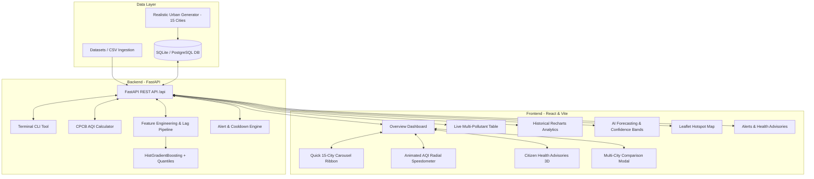

# SmartCity AirGuard AI 🌬️🏛️
### Intelligent Urban Air Pollution Prediction, Monitoring & Early Warning Platform

[](https://github.com/samk1245/SmartCity-AirGuard-AI-System/actions/workflows/ci.yml)


---

## 1. Executive Summary

**SmartCity AirGuard AI** is an environmental intelligence and predictive analytics platform engineered for Indian metropolitan areas and river basin cities prone to extreme seasonal particulate spikes. It supports **15 major Indian cities and 44 ambient monitoring stations**:

> **Delhi, Lucknow, Prayagraj, Kanpur, Varanasi, Mumbai, Bengaluru, Kolkata, Hyderabad, Ahmedabad, Jaipur, Patna, Agra, Pune, and Chandigarh.**

The system ingests ambient air quality records, implements official **Central Pollution Control Board (CPCB)** National Air Quality Index (NAQI) sub-index calculation, trains non-linear machine learning regressors strictly on **chronological historical data**, provides **multi-step forward forecasts with 10th-90th quantile prediction intervals**, flags threshold violations via a **smart alert engine**, and visualizes hotspots on an **interactive OpenStreetMap Leaflet dashboard with 3D UI components**.

---

## 2. Key Capabilities

1. **CPCB NAQI Multi-Pollutant Engine:**
   - Computes linear sub-indices across $PM_{2.5}, PM_{10}, NO_2, SO_2, CO,$ and $O_3$ using statutory Indian breakpoint intervals.
   - Accurately classifies readings into **Good, Satisfactory, Moderate, Poor, Very Poor, and Severe**.
2. **Chronological Machine Learning Engine:**
   - Avoids future data leakage by implementing time-series splitting (80% train / 20% future held-out test).
   - Generates station-isolated autoregressive lags ($1h, 6h, 12h, 24h$), rolling means, variability, and cyclical sine/cosine time representations.
   - Evaluates `HistGradientBoostingRegressor` and `RandomForestRegressor` against a `DummyRegressor` baseline, delivering over **33.5% MAE improvement**.
   - Defensible quantile regression for 10th and 90th percentile prediction uncertainty envelopes.
3. **Multi-Horizon Forecasting:**
   - On-demand forecasts for $+1h, +6h, +12h, +24h, +48h,$ and $+72h$ horizons with automated autoregressive feedforward.
4. **Fabulous 3D UI & Animated Radial Speedometer:**
   - High-contrast semi-circular AQI gauge with smooth spring needle animation.
   - Layered 3D glossy isometric icons with specular lighting and depth drop shadows.
   - Citizen Health Advisory widget offering tailored recommendations for masks (N95), outdoor fitness, and home ventilation.
   - Multi-city comparison modal to compare any 2 or 3 cities side-by-side.
5. **Interactive Leaflet Geospatial Map:**
   - High-density station markers colored dynamically by real-time AQI category with detailed pollutant popup drawers.
6. **Command-Line CLI Utility (`python -m app.cli`):**
   - Direct terminal inspection of live readings, multi-hour forecasting, and model retraining.
7. **Production-Ready Containerization & CI/CD:**
   - Multi-stage Dockerfiles and Docker Compose orchestration.
   - GitHub Actions CI pipeline running tests across Python 3.11, 3.12, and 3.13.

---

## 3. System Architecture



---

## 4. Supported Urban Monitoring Stations (15 Cities / 44 Stations)

| City | State / Zone | Stations Reporting |
| :--- | :--- | :--- |
| **Delhi** | NCR | Anand Vihar, RK Puram, Punjabi Bagh, ITO |
| **Lucknow** | Uttar Pradesh | Hazratganj, Talkatora Industrial, Gomti Nagar |
| **Prayagraj** | Uttar Pradesh | Civil Lines, Jhunsi, Phaphamau |
| **Kanpur** | Uttar Pradesh | Nehru Nagar, Kalyanpur |
| **Varanasi** | Uttar Pradesh | Bhelupur, BHU Campus, Ardali Bazar |
| **Mumbai** | Maharashtra | BKC, Colaba Coastal, Andheri East, Navi Mumbai |
| **Bengaluru** | Karnataka | BTM Layout, Silk Board, Whitefield, Peenya |
| **Kolkata** | West Bengal | Victoria Memorial, Rabindra Bharati, Salt Lake |
| **Hyderabad** | Telangana | Sanathnagar, HITEC City, Charminar |
| **Ahmedabad** | Gujarat | Maninagar, Chandkheda, Vatva Industrial |
| **Jaipur** | Rajasthan | Mansarovar, Shastri Nagar, Sitapura |
| **Patna** | Bihar | Samanpura, Danapur, Shikarpur |
| **Agra** | Uttar Pradesh | Taj East Gate, Sanjay Place |
| **Pune** | Maharashtra | Shivajinagar, Hinjawadi IT Park |
| **Chandigarh** | Chandigarh | Sector 22 Commercial, Sector 53 Nature Park |

---

## 5. Quickstart & Execution

### Option A: Dual-Service Launcher (Windows PowerShell)
```powershell
.\run_all.ps1
```
- **Web App:** [http://localhost:5173](http://localhost:5173)
- **API Swagger Docs:** [http://localhost:8000/docs](http://localhost:8000/docs)

---

### Option B: Docker Compose (Cross-Platform)
```bash
docker compose up --build
```
Runs both the backend and frontend containers with automatic health checks.

---

### Option C: Manual Setup

#### 1. Backend Setup
```powershell
cd backend
py -3.13 -m venv venv
.\venv\Scripts\Activate.ps1
pip install -r requirements.txt
python -m app.db.seed
python -m app.ml.train
pytest -v
python -m uvicorn app.main:app --host 0.0.0.0 --port 8000 --reload
```

#### 2. Frontend Setup
```powershell
cd frontend
npm install
npm run build
npm run dev
```

---

## 6. Interactive Terminal CLI

SmartCity AirGuard AI includes a standalone terminal interface:

```powershell
# 1. Query real-time city observations
python -m app.cli current --city Delhi
python -m app.cli current --city Mumbai

# 2. Run forward ML forecast from terminal
python -m app.cli forecast --station "Civil Lines" --hours 24

# 3. Retrain model directly
python -m app.cli train --algo HistGradientBoosting
```

---

## 7. Postman API Collection

Import [`SmartCity_AirGuard_AI.postman_collection.json`](SmartCity_AirGuard_AI.postman_collection.json) directly into Postman to explore and test all 11 endpoints with pre-configured requests and responses.

---

## 8. Author & License

- **Author:** Samir Khan ([@samk1245](https://github.com/samk1245))
- **Repository:** [https://github.com/samk1245/SmartCity-AirGuard-AI-System](https://github.com/samk1245/SmartCity-AirGuard-AI-System)
- **License:** [MIT License](LICENSE)
