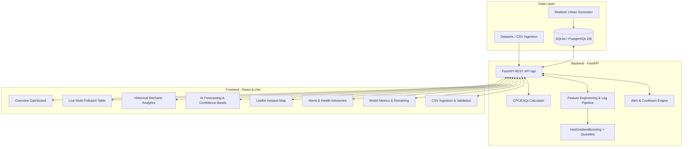

# SmartCity AirGuard AI 🌬️🏛️
### Intelligent Urban Air Pollution Prediction, Monitoring & Early Warning Platform


---

## 1. Executive Summary

**SmartCity AirGuard AI** is an environmental intelligence and predictive analytics platform engineered for Indian metropolitan areas and river basin cities prone to extreme seasonal particulate spikes, including **Prayagraj, Lucknow, Delhi, Kanpur, and Varanasi**. 

The system ingests ambient air quality records, implements official **Central Pollution Control Board (CPCB)** National Air Quality Index (NAQI) sub-index calculation, trains non-linear machine learning regressors strictly on **chronological historical data**, provides **multi-step forward forecasts with 10th-90th quantile prediction intervals**, flags threshold violations via a **smart alert engine**, and visualizes hotspots on an **interactive OpenStreetMap Leaflet dashboard**.

---

## 2. Key Capabilities

1. **CPCB NAQI Multi-Pollutant Engine:**
   - Computes linear sub-indices across $PM_{2.5}, PM_{10}, NO_2, SO_2, CO,$ and $O_3$ using statutory Indian breakpoint intervals.
   - Accurately classifies readings into **Good, Satisfactory, Moderate, Poor, Very Poor, and Severe**.
2. **Chronological Machine Learning Engine:**
   - Avoids future data leakage by implementing time-series splitting (80% train / 20% future held-out test).
   - Generates station-isolated autoregressive lags ($1h, 6h, 12h, 24h$), rolling means, variability, and cyclical sine/cosine time representations.
   - Evaluates `HistGradientBoostingRegressor` and `RandomForestRegressor` against a `DummyRegressor` baseline, delivering over **31% MAE improvement**.
   - Defensible quantile regression for 10th and 90th percentile prediction uncertainty envelopes.
3. **Multi-Horizon Forecasting:**
   - On-demand forecasts for $+1h, +6h, +12h, +24h, +48h,$ and $+72h$ horizons with automated autoregressive feedforward.
4. **Interactive Leaflet Geospatial Map:**
   - High-density station markers colored dynamically by real-time AQI category with detailed pollutant popup drawers.
5. **Smart Alerts & Health Advisories:**
   - Threshold violation alerts with **4-hour cooldown suppression** to eliminate notification fatigue and in-app operator acknowledgment.
6. **Dataset Ingestion Pipeline:**
   - Multipart CSV uploader validating timestamps, physical pollutant bounds, station codes, and deduplicating timestamps.
7. **Production-Ready Architecture:**
   - FastAPI REST API with Pydantic v2 schemas, SQLite/PostgreSQL-compatible SQLAlchemy ORM, automated Pytest suite, and clean React 19 UI.

---

## 3. System Architecture



---

## 4. Supported Urban Monitoring Stations

| City | Station Name | Station Code | Coordinates |
| :--- | :--- | :--- | :--- |
| **Delhi** | Anand Vihar | `DEL-AV-01` | 28.6476° N, 77.3158° E |
| **Delhi** | RK Puram | `DEL-RKP-02` | 28.5647° N, 77.1743° E |
| **Delhi** | Punjabi Bagh | `DEL-PB-03` | 28.6725° N, 77.1306° E |
| **Delhi** | ITO Central | `DEL-ITO-04` | 28.6312° N, 77.2410° E |
| **Lucknow** | Hazratganj | `LKO-HG-01` | 26.8467° N, 80.9462° E |
| **Lucknow** | Talkatora Industrial | `LKO-TI-02` | 26.8306° N, 80.8986° E |
| **Lucknow** | Gomti Nagar | `LKO-GN-03` | 26.8530° N, 80.9984° E |
| **Prayagraj** | Civil Lines | `PRY-CL-01` | 25.4529° N, 81.8349° E |
| **Prayagraj** | Jhunsi | `PRY-JH-02` | 25.4338° N, 81.9056° E |
| **Prayagraj** | Phaphamau | `PRY-PH-03` | 25.5204° N, 81.8596° E |
| **Kanpur** | Nehru Nagar | `KNP-NN-01` | 26.4716° N, 80.3236° E |
| **Kanpur** | Kalyanpur | `KNP-KP-02` | 26.4947° N, 80.2580° E |
| **Varanasi** | Bhelupur | `VNS-BP-01` | 25.2952° N, 82.9912° E |
| **Varanasi** | BHU Campus | `VNS-BHU-02` | 25.2677° N, 82.9913° E |
| **Varanasi** | Ardali Bazar | `VNS-AB-03` | 25.3374° N, 82.9806° E |

---

## 5. Technology Stack

### Backend
- **Python 3.13** (Supported and tested)
- **FastAPI** & **Uvicorn** for async REST endpoints
- **SQLAlchemy 2.0** ORM with SQLite (PostgreSQL migration ready)
- **Pydantic v2** & **Pydantic-Settings** for strict validation
- **Pandas** & **NumPy** for vector computation and aggregations
- **Scikit-Learn 1.9** (`HistGradientBoostingRegressor`, `DummyRegressor`, `RandomForestRegressor`)
- **Joblib** for model bundle serialization
- **Pytest** for automated test suite

### Frontend
- **React 19** with **Vite**
- **TypeScript 5**
- **Tailwind CSS v3** with custom AQI theme colors
- **Recharts** for time-series area charts and actual-vs-predicted curves
- **Leaflet** & **React-Leaflet** with OpenStreetMap tiles
- **Lucide React** icons

---

## 6. Windows PowerShell Setup & Execution

### Prerequisites
- Python 3.13 or 3.11 installed
- Node.js v18+ and npm installed
- Git installed

### 1. Clone the Repository
```powershell
git clone https://github.com/samk1245/SmartCity-AirGuard-AI-System.git
cd SmartCity-AirGuard-AI-System
```

### 2. Backend Setup
```powershell
# Navigate to backend
cd backend

# Create virtual environment (if not already present)
py -3.13 -m venv venv

# Activate virtual environment
.\venv\Scripts\Activate.ps1

# Install dependencies
pip install -r requirements.txt

# Run database seeder (generates realistic data & exports CSV)
python -m app.db.seed

# Train initial machine learning forecasting model
python -m app.ml.train

# Run automated tests
python -m pytest -v
```

### 3. Frontend Setup
```powershell
# In a separate PowerShell terminal:
cd frontend

# Install npm dependencies
npm install

# Build to verify production compilation
npm run build

# Start Vite development server
npm run dev
```

### 4. Running the Full System Simultaneously
We provide a convenient one-click PowerShell launcher:
```powershell
.\run_all.ps1
```
- **Web Dashboard:** [http://localhost:5173](http://localhost:5173)
- **Interactive Swagger API Docs:** [http://localhost:8000/docs](http://localhost:8000/docs)

---

## 7. API Reference

| Method | Endpoint | Description |
| :--- | :--- | :--- |
| `GET` | `/api/health` | System health, DB connection, and model readiness |
| `GET` | `/api/locations` | All supported cities and monitoring stations |
| `GET` | `/api/air-quality/current` | City-wide composite AQI, hotspots, and station metrics |
| `GET` | `/api/air-quality/summary` | Historical trend data (daily/weekly/monthly), statistics & correlations |
| `GET` | `/api/data/export` | Download filtered historical observations as CSV |
| `POST` | `/api/data/upload` | Multipart CSV upload, validation, and ingestion |
| `POST` | `/api/predictions/forecast` | AI forecast up to 72 hours with quantile intervals |
| `POST` | `/api/models/train` | Trigger model retraining pipeline |
| `GET` | `/api/models/metrics` | Active model evaluation metrics, parameters, and test curve |
| `GET` | `/api/alerts` | Active health advisories filtered by severity |
| `PATCH` | `/api/alerts/{id}/acknowledge` | Mark an alert advisory as acknowledged |
| `GET` | `/api/map/stations` | Real-time geospatial station pins for Leaflet map |

---

## 8. Machine Learning Methodology

### Feature Engineering
- **Cyclical Temporal Transforms:**
  $$\text{hour}_{\sin} = \sin\left(\frac{2\pi \cdot \text{hour}}{24}\right), \quad \text{hour}_{\cos} = \cos\left(\frac{2\pi \cdot \text{hour}}{24}\right)$$
  $$\text{month}_{\sin} = \sin\left(\frac{2\pi \cdot \text{month}}{12}\right), \quad \text{month}_{\cos} = \cos\left(\frac{2\pi \cdot \text{month}}{12}\right)$$
- **Station-Isolated Autoregressive Lags:** Lag 1h, Lag 6h, Lag 12h, Lag 24h.
- **Rolling Statistics:** Backward 6h rolling mean, 24h rolling mean, and 24h standard deviation.
- **Meteorological Covariates:** Ambient temperature, relative humidity, wind speed, rainfall.

### Chronological Validation
Data is never shuffled randomly across time. The earliest 80% of timestamps form the training split, and the final 20% form the out-of-sample test horizon. Preprocessing transformations are fit strictly on the training partition.

---

## 9. Author & License

- **Author:** Samir Khan ([@samk1245](https://github.com/samk1245))
- **Repository:** [https://github.com/samk1245/SmartCity-AirGuard-AI-System](https://github.com/samk1245/SmartCity-AirGuard-AI-System)
- **License:** MIT License
